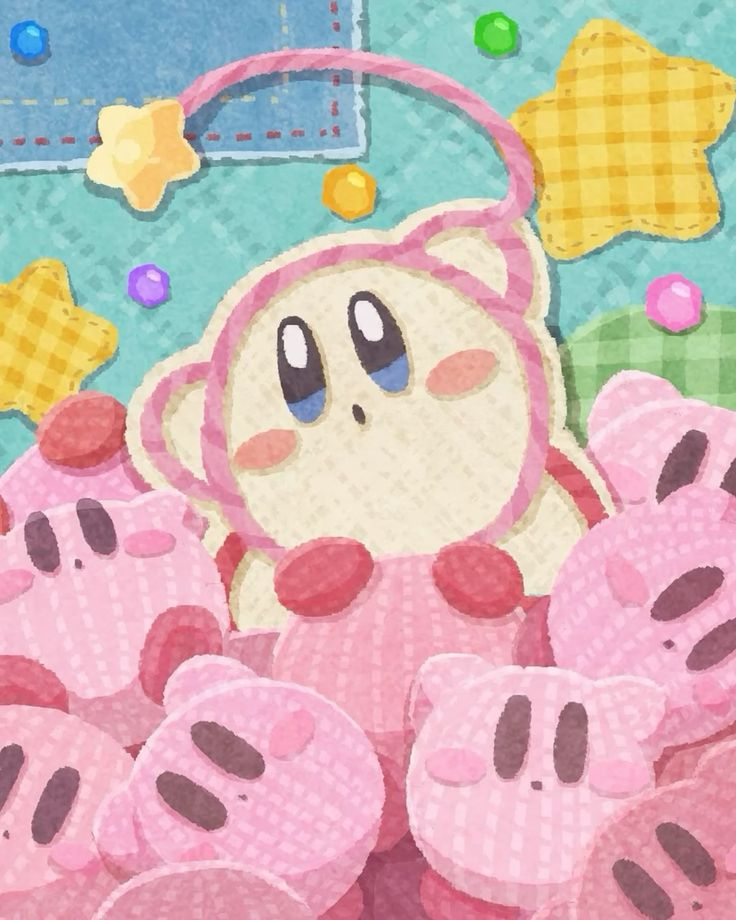
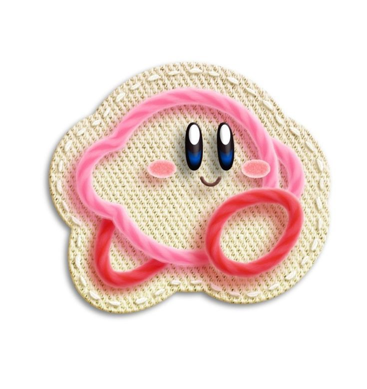
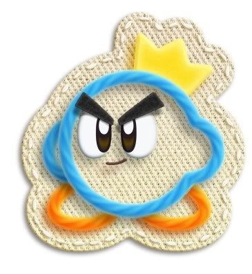
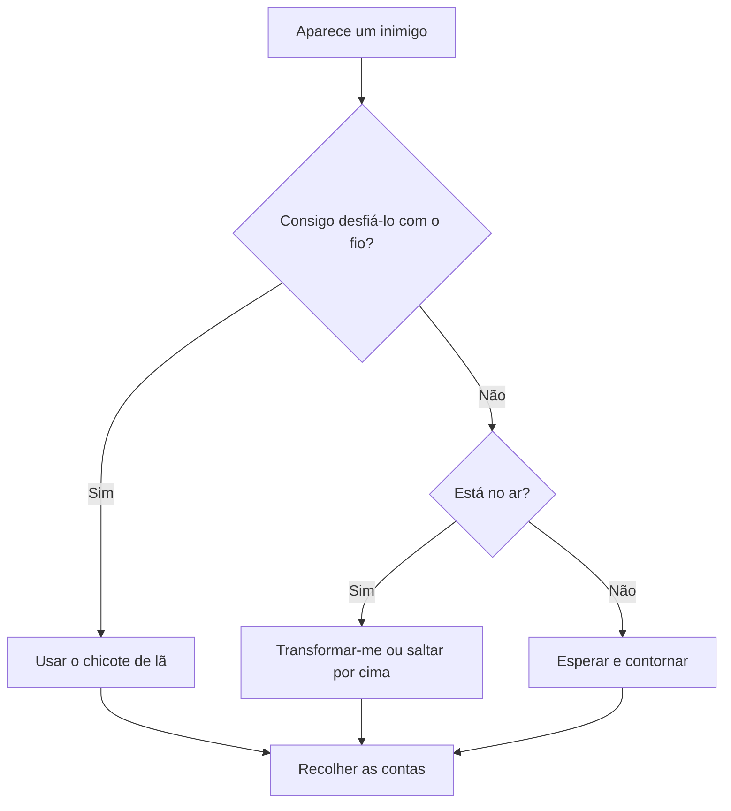

# Kirby's Epic Yarn

## Introdução ao jogo:

*Kirby's Epic Yarn* e um jogo de plataforma 2D, o jogo apresenta uma aventura diferente das habituais de Kirby: em vez de um mundo feito de materiais tradicionais, tudo parece construído com fios, lã, tecido, botões e retalhos. O resultado é um universo colorido, criativo e encantador.

# Personagens jogaveis

## **Kirby** 

### *Habilidades:*

1. Transformações de Estambre 
2. Yarn Whip 
3. Manipulação de Fios
4. Super Transformações
5. Auxílio em Kirby's Extra Epic Yarn

## **Prince Fluff** 

  

### *Habilidades:* 

1. Chicote de Lã (Yarn Whip) 
2. Paraquedas
3. Manipulação de peso
4. Transformarse num carro

## História/Enredo de Kirby’s Epic Yarn

Tudo começa em Dream Land, quando o feiticeiro Yin-Yarn usa uma meia mágica para sugar o Kirby para um mundo feito de tecido e lã, chamado Patch Land. Lá, o Kirby fica transformado em lã e perde a capacidade de sugar os inimigos.

Yin-Yarn também rasga o Fio Mágico que mantém o mundo unido, dividindo Patch Land em várias partes. O Kirby faz equipa com o Príncipe Fluff e ambos viajam por vários mundos para recuperar os pedaços do Fio Mágico e restaurar Patch Land.

No final, o Kirby derrota Yin-Yarn, o mundo é reconstruído e ele regressa a Dream Land.

Se precisares de uma versão ainda mais curta (2 ou 3 frases) ou com um tom mais formal para a folha de design, diz-me.

## Estratégia geral

O Kirby não morre neste jogo: quando leva dano, perde contas. Por isso, a melhor estratégia é proteger as contas para ganhar medalhas.

### Fluxograma: como reagir a um inimigo

## Links

 [Kirby's Epic Yarn - wikipedia](https://en.wikipedia.org/wiki/Kirby%27s_Epic_Yarn)

 [Kirby's Epic Yarn - image](https://uk.pinterest.com/pin/230528074717155010/)

[Kirby's Epic Yarn - fandom_wiki](https://kirby.fandom.com/wiki/Kirby%27s_Epic_Yarn)

